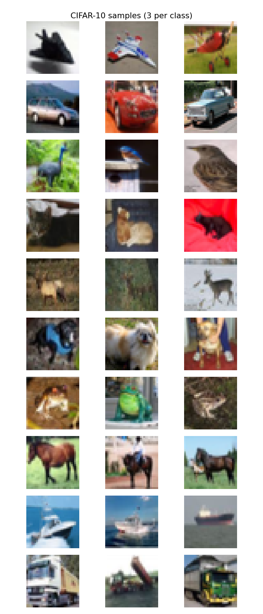
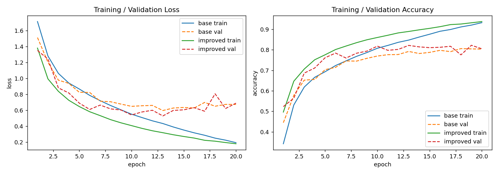
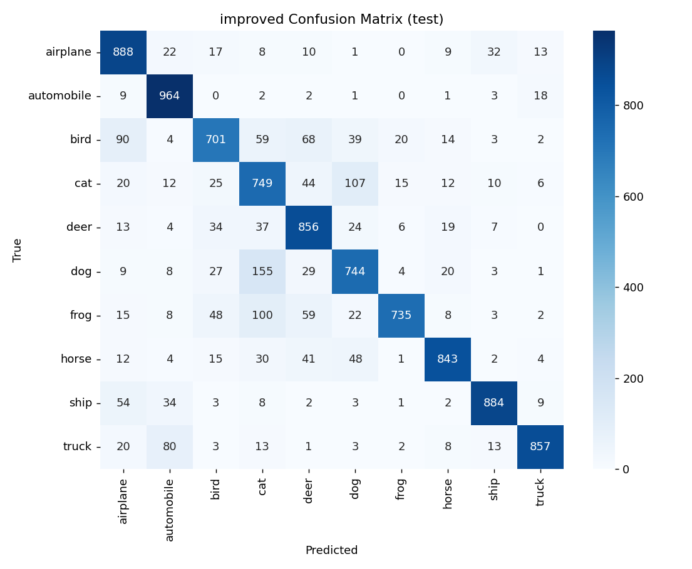

# 作业 5：卷积神经网络实战 —— CIFAR-10 十分类

姓名：张曦尧　　学号：2025090911030

代码在 `ml-5-张曦尧-2025090911030.py`，直接 `python ml-5-张曦尧-2025090911030.py` 就能跑（数据会自动下载到 `./data`）。报告里用到的图都在 `figures/` 文件夹下。

---

## 一、认识数据

CIFAR-10 每张图是 3×32×32 的彩色小图，一共 10 类：airplane、automobile、bird、cat、deer、dog、frog、horse、ship、truck。

按题目建议，我把原来的 50000 张训练集用固定随机种子切成了 **45000 训练 / 5000 验证**，官方自带的 10000 张当测试集。这样两个模型看到的训练/验证划分完全一样，对比才公平。

每类随机抽 3 张画出来长这样（`figures/data_samples.png`）：



肉眼看下来几个感受：
- **cat 和 dog 真的很像**，尤其是毛茸茸的小动物、正面照那种，32×32 分辨率下细节糊成一团，人都得仔细看；
- **bird/frog/deer** 都是自然场景，背景经常是树/草/水，容易互相混；
- **ship 和 airplane** 都是人造物体，但 ship 经常是海天一色、airplane 是天空背景，理论上好分；
- **automobile 和 truck** 都是车，正侧面照也容易混。

预处理上我只做了 `ToTensor + Normalize`，均值方差用的是 CIFAR-10 官方那组 (0.4914, 0.4822, 0.4465) / (0.2470, 0.2435, 0.2616)，没做数据增强（这个后面改进部分会说）。

---

## 二、基础 CNN 结构

我搭了一个 3 段式的小网络，每段是"两个 3×3 卷积 + ReLU + MaxPool(2)"，最后接全局平均池化 + 全分类层。结构是：

```
Input (3, 32, 32)
├─ Conv 3→32, 3×3, pad=1 → ReLU        # (32, 32, 32)
├─ Conv 32→32, 3×3, pad=1 → ReLU       # (32, 32, 32)
├─ MaxPool 2×2                          # (32, 16, 16)
├─ Conv 32→64, 3×3, pad=1 → ReLU       # (64, 16, 16)
├─ Conv 64→64, 3×3, pad=1 → ReLU       # (64, 16, 16)
├─ MaxPool 2×2                          # (64, 8, 8)
├─ Conv 64→128, 3×3, pad=1 → ReLU      # (128, 8, 8)
├─ Conv 128→128, 3×3, pad=1 → ReLU    # (128, 8, 8)
├─ MaxPool 2×2                          # (128, 4, 4)
├─ AdaptiveAvgPool2d(1)                 # (128, 1, 1)
├─ Flatten                              # (128,)
└─ Linear 128→10                        # (10,)
```

参数量 **288,298**。没用 torchvision 自带的模型，都是 `nn.Conv2d` / `nn.MaxPool2d` 一层一层拼的。

这里特意用了全局平均池化（`AdaptiveAvgPool2d(1)`）而不是直接 Flatten——Flatten 之后第一层全连接参数会爆炸（128×4×4=2048 个输入），GAP 把每张特征图平均成一个数，既减少参数又能让网络对空间位置不那么敏感。

---

## 三、训练过程

**损失函数**：`CrossEntropyLoss`（十分类标配，内部自带 log_softmax）。
**优化器**：Adam，lr=1e-3。
**超参数**：batch_size=128，epochs=20，随机种子 42。

训练循环里这三行是固定套路，题目让解释一下：

```python
optimizer.zero_grad()   # 把上一个 batch 累积的梯度清零
loss.backward()         # 反向传播，自动算每个参数的梯度
optimizer.step()        # 用刚算出来的梯度更新权重
```

- `zero_grad()`：PyTorch 的梯度是默认累加的，如果不清零，这个 batch 的梯度会叠在上个 batch 上，相当于学习率莫名其妙变大；
- `backward()`：自动微分，从 loss 开始链式求导，每个参数张量的 `.grad` 就被填好了；
- `step()`：optimizer 按自己的策略（Adam 就是动量+自适应学习率）用这些梯度更新权重。

训练曲线在 `figures/curves.png`：



基础 CNN 跑下来：
- 训练准确率一路升到 93.2%，验证准确率在 epoch 18 见顶 **80.58%**，之后就开始震荡不涨了——典型的过拟合苗头（训练 loss 还在降，val loss 从 epoch 10 左右就开始原地抖甚至抬头）。
- 最后用验证集最优那版权重（epoch 18）在测试集上测，**测试准确率 79.77%**。

---

## 四、改进 CNN：BatchNorm + Dropout

我在基础 CNN 上做的改进是：**每个卷积后面加 BatchNorm2d，最后分类前加一个 Dropout(0.5)**。其他一切（数据划分、epoch 数、batch size、学习率、优化器）都和基础版保持一致，保证公平对比。

改进版结构就是在上面每个 Conv 后面插一个 `BatchNorm2d`，Flatten 之后、Linear 之前插一个 `Dropout(0.5)`。参数量 **289,194**，比 base 只多了 896 个（就是 BatchNorm 里的 gamma/beta），基本可以忽略。

**为什么觉得这俩能涨点**：
- BatchNorm 把每层输出拉回均值 0 方差 1，缓解内部协变量偏移，收敛更快、对学习率没那么敏感；
- Dropout 随机丢掉一半神经元，强迫网络不要太依赖某几个特征，压过拟合。

**对比结果**：

| 模型 | 验证集准确率 | 测试集准确率 | 参数量 |
|---|---|---|---|
| 基础 CNN | 0.8058（@epoch 18） | 0.7977 | 288,298 |
| 改进 CNN（BN+Dropout） | **0.8220（@epoch 19）** | **0.8221** | 289,194 |

改进版测试集比 base 高了 **2.44 个百分点**，而且从曲线上看：
- 训练 loss 降到 0.18，比 base 的 0.19 还低，但验证 loss 最低压到了 0.53（base 最低 0.60），val loss 后期虽然也抖，但整体比 base 稳；
- val accuracy 稳定在 0.80~0.82，base 在 0.77~0.80 晃。

结果符合预期。20 个 epoch 还太短，要是加数据增强、再训到 50~100 epoch、加个学习率衰减，应该还能再涨。

---

## 五、模型到底看懂了吗？

### 5.1 测试集整体表现

改进模型在 10000 张测试图上准确率 **82.21%**。

每类召回率（改进版）：

| 类别 | 召回率 | | 类别 | 召回率 |
|---|---|---|---|---|
| airplane | 0.888 | | dog | 0.744 |
| automobile | **0.964** | | frog | 0.735 |
| bird | 0.701 | | horse | 0.843 |
| cat | 0.749 | | ship | 0.884 |
| deer | 0.856 | | truck | 0.857 |

最好认的是 automobile（96.4%）和 ship（88.4%），最难认的是 bird（70.1%）、frog（73.5%）和 cat（74.9%）——都是小动物/自然场景类。

### 5.2 混淆矩阵

改进模型的混淆矩阵在 `figures/confusion_improved.png`（基础版在 `figures/confusion_base.png`）：



非对角线上比较扎眼的几个：
- **dog → cat：155 张**（15.5% 的狗被认成猫）；
- **cat → dog：107 张**（10.7% 的猫被认成狗）；
- **ship → airplane：54 张**（船被认成飞机，主要是白底/天空背景的船）；
- **bird → airplane：90 张**、**bird → dog：39 张**、**bird → deer：68 张**——bird 简直是"万金油"，跟谁都能混一点；
- **truck → automobile：80 张**。

### 5.3 预测正确 / 错误的样本

代码里随机挑了 8 张预测对的和 8 张预测错的画出来：
- 正确样本：`figures/samples_correct_improved.png`
- 错误样本：`figures/samples_wrong_improved.png`

错误样本看下来，基本都是"32×32 本身就糊"的那种：猫和狗的毛色/姿势接近、bird 和 plane 都是天上的小点、ship 在远处跟 airplane 一个轮廓。

### 5.4 cat / dog 为什么容易混

专门统计了一下：
- base 模型：cat→dog 110/1000（11.0%），dog→cat 157/1000（15.7%）；
- 改进模型：cat→dog 107/1000（10.7%），dog→cat 155/1000（15.5%）。

加了 BN+Dropout 之后只改善了一点点，说明这俩类的混淆不是过拟合带来的，而是**数据本身和任务难度**的问题：

1. **分辨率太低**：32×32 展开才 1024 个像素，猫和狗的关键区分特征（耳朵形状、口鼻长度、眼睛位置）在这个分辨率下基本糊掉，人都要靠颜色和大致轮廓猜；
2. **姿态和颜色太像**：都是四足哺乳动物，经常出现正面坐、侧面站，毛色又都有橘色/灰色/白色；
3. **背景干扰**：猫经常在室内沙发上、狗在户外草地上，但小网络的感受野不够大，抓不到背景这个线索；
4. **类别本身的样本多样性**：CIFAR-10 里猫和狗各 5000 张，但包含的品种、光照、角度太多，小网络很难学出一个稳定的判别边界。

我觉得主要瓶颈是**分辨率和模型容量**，不是结构问题——真要解决这个，得上更深的网络（ResNet）+ 数据增强（随机裁剪、水平翻转）+ 更长时间训练。

---

## 六、收获与反思

- 第一次完整手写一个 CNN 从数据加载到出图的全流程，比之前调 torchvision 预训练模型理解深多了。尤其是卷积输出尺寸的计算，一开始算错了 Flatten 那层的输入维度，报了几次 shape mismatch 才搞明白。
- BatchNorm 和 Dropout 的作用这次有了直观对比：基础版 train acc 93% 但 val 卡在 80%，加了 BN+Dropout 之后 val 直接拉到 82%，而且 val loss 曲线稳了不少。
- 对"32×32 到底够不够用"有了体感：cat/dog 这种类间差异本来就细，分辨率一低神仙也难分。
- 代码里 `show_layer_shapes` 这个函数很有用， forward 之前先把每层的 tensor shape 打出来，比盲调快多了。
- **没做的事 / 以后可以加的**：数据增强（随机翻转、随机裁剪）；学习率调度；残差连接（题目里的拓展挑战）；把 epochs 从 20 加到 50+；K 折交叉验证。这次时间有限先交个 baseline。

---

*环境：Python 3.9 / PyTorch 2.5.1 / RTX 5060 Laptop GPU；随机种子 42，所有实验同一份数据划分。*
