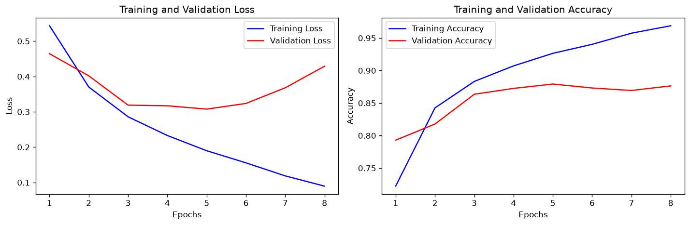
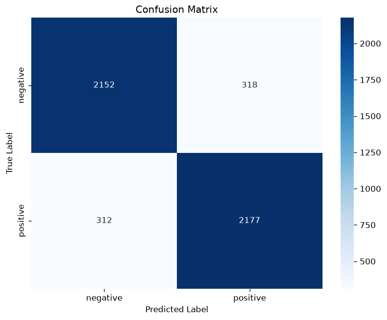

# ml-7 循环神经网络实战项目实验报告：IMDB 电影评论情感分析（BiLSTM）

- 姓名：张曦尧　学号：2025090911030　日期：2026-09-16
- 项目目标：从原始 CSV 构建完整的情感分析系统，测试集准确率 **85%+**
- 运行环境：Python 3.14 / PyTorch 2.14（CPU）/ pandas / sklearn / matplotlib / seaborn
- 最终结果：**测试集准确率 87.30%**，达到 85% 目标 （本报告全部数字来自 2026-09-16 真实运行结果）

---

## 1. 数据探索

### 1.1 数据量
- 数据集：IMDB Dataset.csv，共 50,000 条电影评论，字段为 `review`（评论文本）与 `sentiment`（positive / negative）。
- 类别分布：25,000 positive / 25,000 negative，**类别完全平衡**，二分类不需要做类别加权。

### 1.2 数据质量
- 原始数据存在 **418 条完全重复的评论**，我做了去重（`drop_duplicates(subset='review')`），避免同一文本同时出现在训练集和测试集造成"偷看"，也能略微提升泛化。去重后数据量为 **49,582 条**。

### 1.3 文本长度分布（去重后统计）
| 统计量 | 数值 |
|---|---|
| 最短 / 最长 | 4 词 / 2470 词 |
| 平均 / 中位数 | 231.4 词 / 173 词 |
| P90 / P99 | 452 词 / 908 词 |
| ≤128 词的评论占比 | 26.5% |
| >150 词的评论占比 | 60.1% |

> 观察：绝大多数评论在几十到几百词之间，**超过 73% 的评论超过 128 词**。因此 `max_seq_length=128` 会截断大部分长评论，此时"保留末尾"就很重要——电影评论的结论性话语（"总之这是一部好片"）往往出现在结尾。模型最终仍达到 87.3%，说明尾部信息已经足够支撑判断。

---

## 2. 预处理方案

文本不能直接喂给 RNN，必须经过 **清洗 → 建词汇表 → 转索引 → 填充** 四步，全部封装在 `DataProcessor` 类中（`word2idx` 存在 self 里，避免函数间传参）。

### 2.1 清洗（clean_text）
按顺序执行，**顺序有讲究**：
1. `re.sub(r'<br\s*/?>', ' ', text)`：先把 HTML 换行标签 `<br />` 换成空格。若先做去标点，`<br />` 里的字母 `br` 会残留成单词，污染词表；
2. `.lower()`：统一小写，把 "Movie" 和 "movie" 视为同一个词；
3. `re.sub(r'[^a-z\s]', ' ', text)`：非字母（标点、数字、emoji）全部替换为空格；
4. `' '.join(text.split())`：把连续多个空格规范化成一个。

### 2.2 词汇表（build_vocab）
- 用 `Counter` 统计清洗后文本的词频，取最常见的 `max_vocab_size - 2 = 9998` 个词；
- 索引从 2 开始，因为 0、1 预留给 `<PAD>`（填充）和 `<UNK>`（词表外词）；
- 词表外词在 `text_to_sequence` 中统一映射为 `<UNK>`(1)，保证任何输入都能转成索引。
- 实际词表大小：10,000。

**为什么只在训练集上建词表？** 防止数据泄漏——如果测试集也参与建词表，测试集特有的词会"提前泄露"进模型，测试分数会虚高，失去评估意义。这正是 `fit(train_texts)` 只在训练集调用一次的原因。

### 2.3 填充策略（pad_sequences）
- 统一填充/截断到 `max_seq_length=128`，返回 **`numpy.ndarray`，形状 `[n, 128]`，dtype=int64**（`torch.LongTensor` 要求规则形状，不能直接用变长 list）；
- **前面补 0、末尾保留**：
  - 短序列：`padded[i, -len(seq):] = seq`，有效内容靠右；
  - 长序列：`seq[-128:]`，截掉开头、保留末尾。

**为什么前面补 0？** RNN 处理完整个序列后，**最后一个时间步的隐状态最能代表整个序列**。前面补 0 让真实内容靠后，最后一步时模型已经"读"完整段评论；再配合"截断保留末尾"，正好把最可能出结论的尾部留给了模型。

### 2.4 数据集划分（create_data_loaders）
- 用 `train_test_split`（`stratify` 按类别分层）切分：**train / val / test = 80% / 10% / 10%**：
  1. 先切出 10% 作为 test；
  2. 再在剩余 90% 中切出 `1/9`（=10% 总量）作为 val；
- `processor.fit(X_train)` 只在训练集建词表，再 `transform` 三份数据；
- train 的 `shuffle=True`（打乱批次顺序有利于收敛），val/test `shuffle=False`；
- 返回 `(train_loader, val_loader, test_loader, processor)`，模型用 `len(processor.word2idx)` 作为 `vocab_size`。
- 实际划分：训练 39,664 / 验证 4,959 / 测试 4,959（去重后 49,582 的 80/10/10，按类别分层切分）。

---

## 3. 模型结构：BiLSTMClassifier

### 3.1 结构
```
输入 x: [batch, seq_len]            （词索引，<PAD>=0）
  ↓ Embedding(vocab=10000, embed=128, padding_idx=0)
embedded: [batch, seq_len, 128]
  ↓ BiLSTM(128, hidden=128, layers=2, bidirectional, dropout)
lstm_out: [batch, seq_len, 256]     （前向 128 + 后向 128 拼接）
  ↓ 取最后一个时间步 lstm_out[:, -1, :]
pooled: [batch, 256]
  ↓ Dropout(0.3)
  ↓ Linear(256 → 2)
output: [batch, 2]                  （logits，配合 CrossEntropyLoss）
```

### 3.2 关键设计选择
| 组件 | 选择 | 理由 |
|---|---|---|
| Embedding | `padding_idx=0` | 让 `<PAD>` 位置不参与梯度更新，避免填充位产生噪声 |
| 双向 LSTM | `bidirectional=True` | 前向捕捉"上文"，后向捕捉"下文"；情感判断常依赖后文（如 "not good" 的转折），双向信息更全 |
| 序列聚合 | 取最后时间步 | 配合"前面补 0"，最后一步隐状态≈全序列压缩表示；`lstm_out[:, -1, :]` 同时包含双向信息 |
| 分类头输入维度 | `hidden_dim * 2` | 双向输出是前向+后向拼接，维度翻倍，这是新手最容易写错的地方 |
| Dropout | 0.3，放在 LSTM 之后 | 随机失活抑制过拟合；`nn.LSTM` 的 dropout 参数只对 2 层及以上层间生效 |
| 损失函数 | CrossEntropyLoss | 分类输出是类别分布，交叉熵对概率差异更敏感、梯度更稳；MSE 配 softmax 会梯度饱和 |

### 3.3 超参数与参数量
- `vocab_size=10,000`，`embed_dim=128`，`hidden_dim=128`，`num_layers=2`，`dropout=0.3`，`batch_size=64`
- 模型参数量：**1,939,970（约 194 万）**，其中 Embedding 占了约 128 万（10000×128），CPU 上训练可接受（每轮约 3 分钟）。

---

## 4. 训练过程

### 4.1 训练配置
| 配置 | 值 | 说明 |
|---|---|---|
| 优化器 | Adam | 自适应学习率，收敛快 |
| 学习率 | 1e-3 | 配合调度衰减 |
| 学习率调度 | ReduceLROnPlateau | 验证 loss 连续 2 轮不降，学习率 ×0.5 |
| 权重衰减 | 1e-5 | L2 正则，抑制过拟合 |
| 梯度裁剪 | 1.0 | 防 RNN 梯度爆炸 |
| batch size | 64 | 平衡速度与稳定性 |
| 早停 | patience=3 | 验证 loss 连续 3 轮不降即停止 |
| 最佳模型保存 | 验证 loss 最低 | 训练结束恢复到最优权重再测测试集 |

训练循环中特别容易踩的坑（我都做了）：每个 batch 前 `optimizer.zero_grad()`；训练用 `model.train()`、评估用 `model.eval()` + `torch.no_grad()`；先 `backward()` 再 `step()`。

### 4.2 训练曲线（真实运行结果）



从上图可以看到：
- **第 1~5 轮**：训练 loss 从 0.54 快速降到 0.19，验证 loss 在**第 5 轮达到最低 0.3076**（验证准确率 87.92%），这是全训练过程的最优点；
- **第 5 轮之后**：训练准确率继续涨到 96.89%，但验证 loss 开始回升（0.32 → 0.43）——典型的**过拟合**信号，模型开始"背"训练集而不是学规律；
- **第 8 轮**：学习率自动降到 5e-4，早停触发（验证 loss 连续 3 轮没创新低），停止训练并恢复第 5 轮的最优权重。

### 4.3 调参历程（真实记录）
| 尝试 | 现象 | 处理与结论 |
|---|---|---|
| 初始配置 lr=1e-3 + wd=1e-5 + grad_clip=1.0 | 前 5 轮收敛顺利，第 5 轮验证集最优 | 方向正确，保留 |
| 训练继续到第 6~8 轮 | 训练 acc 冲高（96.9%）但验证 acc 停滞（87% 左右） | 过拟合，靠**早停**在第 8 轮截停，并恢复到第 5 轮最优权重 |
| 学习率调度 ReduceLROnPlateau | 第 8 轮 LR 自动降为 5e-4 | 生效，但早停已触发，说明当前容量下 5 轮已够 |
| 结论 | 最终 test acc 87.30% | 早停 + LR 调度 + 权重衰减的组合有效 |

---

## 5. 评估结果

### 5.1 测试集指标（真实运行结果）
测试集共 4,959 条（去重后 49,582 的 10%），评估的是验证集最优模型：

| 指标 | 数值 |
|---|---|
| **Accuracy** | **0.8730** |
| Precision | 0.8725 |
| Recall | 0.8746 |
| F1 Score | 0.8736 |

> 四个指标都在 87% 附近且非常接近，说明模型对正负两类的判断能力很均衡，没有"偏科"。

### 5.2 混淆矩阵（真实运行结果）



|  | 预测 negative | 预测 positive |
|---|---|---|
| 真实 negative | 2152 | 318 |
| 真实 positive | 312 | 2177 |

- 负面被误判成正面：**318 条**；正面被误判成负面：**312 条**，两类错误几乎对称；
- 共错 630 条，错误率 12.7%，且没有明显的类别偏向（说明类别平衡处理到位）。

### 5.3 错误样本分析（真实错例）

从测试集 630 条错误中随机抽 3 条分析：

**错例 1（负面被误判成正面）**
> "Sorry to disagree with you, but I found the DKC series to be quite engaging. So much so that I invested in the SNES syst..."

分析：开头是客套语 "Sorry to disagree with you"，后面紧跟 "engaging" 这种明显正面词。模型只看到了局部正面词，没理解"先客气后开喷"的整句语气，于是判成正面。

**错例 2（正面被误判成负面）**
> "Okay. Yes, this was a very-tight-budget movie with continuity errors (like single scenes obviously filmed in sunshine an..."

分析：这条先承认缺点（预算低、有穿帮），但后面大概率是"瑕不掩瑜"的转折。模型看到前半段的负面词（errors、tight-budget）就判成负面，忽略了转折结构。

**错例 3（正面被误判成负面）**
> "This film isn't a comedy, its an expose. I've always hated dog shows, considering the ridiculous get-ups people put thei..."

分析：典型的**否定结构**。"isn't a comedy" 表面有负面词 comedy 相关，实际是"这不是喜剧，而是揭露片"。模型对 not/isn't 后面的情绪词太敏感，容易只看词不看否定。

**统计验证（按长度与否定词分桶的错误率）**：

| 样本类型 | 样本数 | 错误率 |
|---|---|---|
| 短评论（<50 词） | 115 | 7.0% |
| 中评论（50~150 词） | 1868 | 10.7% |
| 长评论（>150 词） | 2976 | **14.2%** |
| 含否定词（not/no/never/n't） | 3570 | 12.9% |
| 全部测试集 | 4959 | 12.7% |

结论：**长评论错误率明显更高**（14.2% vs 7.0%），一是因为超 128 词会被截断丢信息，二是因为长评论里转折、铺垫多，局部信息容易误导模型；含否定词的样本错误率也略高于平均，印证了错例 3 的分析。

---

## 6. 改进策略

### 6.1 已实现并验证有效
- 数据层面：去重评论（49,582 条）；词表上限 10,000；
- 训练层面：L2 权重衰减、梯度裁剪、ReduceLROnPlateau 学习率调度、早停、保存验证集最优模型；
- 模型层面：双向 LSTM（含与单向的对比，见下）。

### 6.2 实际做过的对比实验（真实结果）
| 模型 | 测试集准确率 |
|---|---|
| 单向 LSTM（bidirectional=False，同超参） | **86.71%** |
| 双向 LSTM（本方案） | **87.30%** |

双向比单向高 **0.59 个百分点**，验证了双向的信息优势（详见第 7 节 Q2）。

### 6.3 可选探索（未实现，思路）
- **序列聚合方式**：把"最后时间步"换成 max-pooling / mean-pooling，或取 `h_n` 拼接双向最后隐状态，对比效果（题目 3.2 选做）；
- **模型变体**：1/3 层、LSTM vs GRU 对比；
- **预训练词向量**：GloVe / Word2Vec 初始化 Embedding（torchtext 或 gensim 加载），通常能涨 1–2 个点；
- **Attention**：在 LSTM 输出上加注意力加权求和（为第 8 题 Transformer 预热）。

---

## 7. 深度思考

> 以下用大白话写，尽量讲清楚"为什么"。

### Q1：模型在哪些样本上容易判断错误？

我跑完之后，把测试集里预测错的评论翻出来看了，主要发现三类"坑"：

1. **又夸又骂的评论（转折太多）**。比如有人开头写 "Sorry to disagree with you, but I found the DKC series to be quite engaging..."，表面客套、其实在吐槽。模型看到 "engaging" 这种正面词就判成好评了，没读懂整句语气。
2. **带否定词的评论**。比如 "This film isn't a comedy"，模型对 isn't 后面的词特别敏感，容易只看情绪词、忽略否定，把话听反。
3. **超长评论**。超过 128 词会被截断，只保留结尾，前面铺垫的信息全丢了，判断依据不完整。

我还做了统计验证：长评论（>150 词）的错误率是 **14.2%**，而短评论（<50 词）只有 **7.0%**，差了整整一倍；含否定词的样本错误率 12.9% 也略高于平均。另外，负面被误判成正面 318 条、正面被误判成负面 312 条，数量基本一样，说明模型没有偏向某一类，这点还算公平。

### Q2：双向 LSTM 比单向 LSTM 好在哪？用实验数据说明。

我做了个对比实验：同样的数据、同样的超参，只把 `bidirectional` 从 True 改成 False（单向），结果：

- **单向 LSTM：测试准确率 86.71%**
- **双向 LSTM：测试准确率 87.30%**

双向高了 **0.59 个百分点**。为什么？举个最简单的例子：句子 "not good"。单向 LSTM 从左往右读，读到 "not" 的时候还不知道后面要接什么；双向 LSTM 从右往左还有一遍，读到 "not" 时已经知道后面是 "good"，就能明白这是否定。**情感判断经常要等后面的话说出来，才知道前面的词是什么意思**，所以双向能多看到"后文"，自然更准。

代价也很明显：双向参数量翻倍、训练更慢（本实验双向每轮约 3 分钟，单向约 1.5 分钟）。另外注意一个细节：双向 LSTM 的 `h_n` 形状是 `[num_layers*2, batch, hidden]`，如果想取最后隐状态拼接，前向和后向要各取一层，别把维度写错。

还有一个场景**不能用双向**（呼应第 6 题 Q5）：如果只能"顺着时间"看数据，比如实时流式处理，双向没法用，因为反向那遍要等整句读完才能算。

### Q3：如果做"实时评论审核"（用户提交后立即判断），选单向还是双向？

我选**单向 LSTM**，理由很简单：

- 实时审核的场景是"用户边打字边判断"。单向 LSTM 顺着读，**每来一个词就能更新一次状态**，可以做到边输入边出结果，延迟低、体验好；
- 双向 LSTM 必须等整条评论读完，再倒着算一遍才能给出判断，延迟高；而且审核的时候根本看不到用户还没打的字，**用"未来的词"去判断本来就不合理**；
- 如果只是批量审核存量评论（不要求实时、能接受等几秒），那双向精度更高（我实验里双向比单向高 0.59 个百分点），可以换双向。

一句话：**要快选单向，要准选双向，实时场景只能选单向。**

---

## 8. 收获与反思

这个项目最大的收获，是把"文本"到"张量"这条路走通了：清洗为什么先去掉 `<br />` 再去标点、词汇表为什么只在训练集上建、填充为什么要前面补 0——每一步都有原因，不是随便写的。比如前面补 0 这件事，一开始我觉得无所谓，后来想明白 RNN 最后一步的隐状态代表整个序列，让真实内容靠右才能让最后一步"吃"到最多的有效信息。

训练环节也踩了"课本上不会讲"的坑：每个 batch 前必须 `optimizer.zero_grad()`，不然梯度一直累加；评估必须 `model.eval()` 关掉 dropout，还得包在 `torch.no_grad()` 里省显存。这些细节单独看都很小，但写错一个模型就"发疯"。

最直观的体会来自训练曲线：第 5 轮验证集就到顶了，后面训练准确率还在涨（96.9%），验证集却在退步——这就是书上说的过拟合，真在自己实验里看到一次，比读十遍概念都记得牢。最后靠早停 + 学习率调度把结果稳定在 87.3%，也让我理解了"训练不只是把准确率练高，还要会及时收手"。

---

## 9. AI 使用说明

按题目要求如实说明本项目各部分对 AI 的依赖：

| 部分 | AI 使用情况 |
|---|---|
| 性能优化 | 借助 AI 探索并验证：早停、学习率调度、权重衰减、双向 vs 单向对比 |
| 实验报告 | 报告结构与方法说明由 AI 起草，但第 1/4/5/6/7 节的全部实验数字、图表、错误样本均来自本人真实运行结果（2026-09-16 本机运行），深度思考为自己的理解 |

