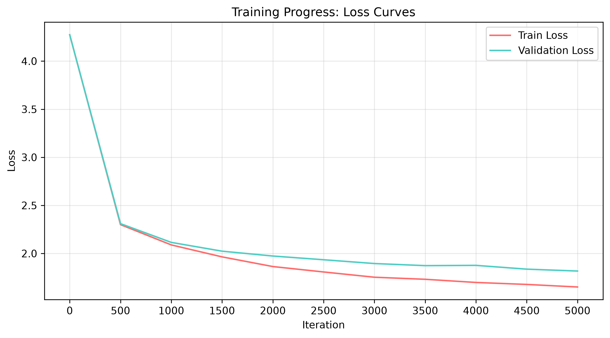

# ML-8 Transformer 作业

> 姓名：________  学号：________
> 第一部分：理论基础问答；第二部分：MiniGPT 实战

---

## 第一部分：理论基础问答

### 0. 引子：为什么 RNN 难以并行？为什么长序列性能差？

- **难以并行**：RNN 按时间步串行计算，`h_t` 依赖 `h_{t-1}`，必须等前一步算完才能算后一步，因此无法像 Transformer 一样对整个序列并行计算。
- **长序列性能差**：RNN 是"顺序压缩"模型，信息从序列开头一路传递到末尾，中间经过大量非线性变换，梯度在时间上反复相乘，容易出现**梯度消失/梯度爆炸**；同时前面的信息会被后续信息"稀释"（长期依赖问题），所以长序列性能差。LSTM/GRU 只是缓解，没有根本解决。

---

### 1. Transformer 的特点是什么？主要解决什么问题？优缺点又是什么？

**出处**：原论文 *Attention Is All You Need*（Vaswani et al., 2017），Section 3 "Model Architecture"、Section 5.4 等。

**特点**：
1. **完全基于注意力机制**：抛弃循环（RNN）和卷积（CNN），只用（自）注意力与前馈网络堆叠；
2. **可并行**：所有位置同时参与计算，训练可充分利用 GPU；
3. **全局依赖建模**：任意两个位置之间只需要一次注意力交互，路径长度为 1，能直接建模长距离依赖；
4. **多头机制**：多个注意力头从不同表示子空间捕捉不同类型的依赖关系；
5. **位置编码**：用正弦/可学习位置编码注入序列顺序信息。

**解决的主要问题**：RNN 的串行瓶颈与长距离依赖（梯度消失）问题，同时大幅提升训练效率。

**优点**：
- 并行度高，训练速度快、易扩展（可堆更多层/更大模型）；
- 长距离依赖建模能力强；
- 架构统一，可扩展到文本、图像、语音等多种模态，是 GPT/BERT 等大模型的基础。

**缺点**：
- **计算复杂度高**：自注意力复杂度为 O(n²)（n 为序列长度），长序列显存和时间开销大；
- **缺少归纳偏置**：没有天然的"局部性/顺序性"先验，小数据上不如 CNN/RNN 容易训练；
- 对位置编码依赖强，位置信息需要显式注入。

---

### 2. Layer Norm vs Batch Norm

| 对比维度 | LayerNorm | BatchNorm |
| --- | --- | --- |
| 归一化维度 | 对**每个样本**的特征维（单条样本内部）做归一化 | 对**每个特征通道**跨 batch 样本做归一化 |
| 计算统计量 | 每条样本独立算均值/方差 | 用整个 batch 的均值/方差 |
| 对 batch 依赖 | 不依赖 batch 大小，训练/推理一致 | 依赖 batch；batch 小时不稳定，推理时需用运行均值 |
| 适用场景 | 序列数据、变长输入、batch 小的场景（NLP 首选） | 视觉任务、固定尺寸输入、batch 较大时（CV 常用） |
| 在 Transformer 中 | 每个 token 的向量内部做标准化，与序列长度/位置无关 | —（Transformer 不用 BN，因为变长序列+小 batch 会导致统计量抖动） |

**"恩怨情仇"总结**：BN 跨样本统计，在 NLP 变长序列和小 batch 下统计量不稳定；LN 沿特征维做归一化，每条样本独立，天然适合序列模型，且不随序列长度变化，因此在 Transformer 中统一使用 LayerNorm。

---

### 3. 位置编码 (Positional Encoding)

**什么是位置编码**：自注意力本身对位置是"对称"的（置换等变），输入顺序换掉，注意力结果不变。为了让模型知道"谁先谁后"，需要在输入上叠加一个表示位置信息的向量，这就是位置编码。

**Transformer 用的位置编码**（原论文 Section 3.5）：**正弦（Sinusoidal）位置编码**：

```
PE(pos, 2i)   = sin(pos / 10000^(2i/d_model))
PE(pos, 2i+1) = cos(pos / 10000^(2i/d_model))
```

- `pos` 是位置下标，`i` 是维度下标，`d_model` 是嵌入维度；
- 偶数维度用 sin，奇数维度用 cos；
- 编码结果直接**加到** token embedding 上。

**这种设计的优势**：
1. **相对位置信息**：由于三角恒等式，`PE(pos+k)` 可以表示为 `PE(pos)` 的线性函数，模型容易学到相对位置关系；
2. **可外推**：正弦函数是周期性的，理论上可外推到比训练时更长的序列；
3. **无需训练**：编码固定、不占参数，计算简单；
4. 现代大模型（如 GPT）多用**可学习位置编码**或 **RoPE（旋转位置编码）**：RoPE 将位置信息以旋转矩阵形式注入 Q/K，外推性更好，已成为主流（本题为选做，详见文末）。

---

### 4. Encoder & Decoder 架构解析

**整体结构**：Encoder 负责"读"，把源序列编码成上下文表示；Decoder 负责"写"，在源上下文的基础上自回归生成目标序列。中间通过 **Cross-Attention** 连接。

```
输入序列 (src)
    │
    ▼
┌───────────────────────── Encoder ─────────────────────────┐
│ Input Embedding + Positional Encoding                      │
│        │                                                   │
│        ▼                                                   │
│  ┌─── Encoder Block × N ───┐                               │
│  │ Self-Attention (多头, Q=K=V 来自同一序列)              │
│  │      + Add & Norm (残差+LayerNorm)                     │
│  │ Feed-Forward (Linear→ReLU→Linear)                      │
│  │      + Add & Norm                                      │
│  └─────────────────────────┘                              │
│        │                                                   │
│        ▼                                                   │
│  LayerNorm                                                 │
└─────────────────────────┬─────────────────────────────────┘
                          │ encoder_output（含源序列全部信息）
                          ▼
┌───────────────────────── Decoder ─────────────────────────┐
│ Target Embedding + Positional Encoding（右移一位）        │
│        │                                                   │
│        ▼                                                   │
│  ┌─── Decoder Block × N ───┐                               │
│  │ Masked Self-Attention (下三角mask, 不能看未来)         │
│  │      + Add & Norm                                      │
│  │ Cross-Attention (Q=Decoder, K,V=Encoder输出)          │
│  │      + Add & Norm                                      │
│  │ Feed-Forward + Add & Norm                              │
│  └─────────────────────────┘                              │
│        │                                                   │
│        ▼                                                   │
│  LayerNorm → Linear → Softmax                              │
└─────────────────────────┬─────────────────────────────────┘
                          ▼
                   输出下一个 token 的概率分布
```

**数据流动**：
1. 源序列 token 经 Embedding 加位置编码进入 Encoder；
2. Encoder 每个 Block 内：**Self-Attention**（Q/K/V 均来自本层输入，各位置互相"交流"）→ 残差 + LN → **FFN** → 残差 + LN，输出上下文表示 `encoder_output`；
3. 目标序列（右移一位，即"预测第 t 个词时只见过前 t-1 个词"）同样做 Embedding + 位置编码进入 Decoder；
4. Decoder 每个 Block 内：**Masked Self-Attention**（下三角 mask 遮挡未来）→ **Cross-Attention**（Query 来自 Decoder 当前层，Key/Value 来自 Encoder 输出，让生成过程"参考"源序列）→ **FFN**，每步都带残差与 LayerNorm；
5. 最后经 Linear + Softmax 输出词表上的概率分布，逐词自回归生成。

**重点细节**：
- Decoder 的 Self-Attention 必须加 mask，否则"作弊"看到答案；
- Cross-Attention 是理解"条件生成"（如翻译、摘要）的关键：生成每一步都在"查询"源信息；
- 虽然 2026 年主流商用模型（如 ChatGPT）采用 Decoder-Only 结构，但原版 Encoder-Decoder 的 Cross-Attention 机制是理解 seq2seq 任务的基石。

---

### 5. 注意力机制核心问题

**K, Q, V 分别代表什么？如何变化？**
- **Q（Query，查询）**：表示"我想找什么"——当前 token 去查询其他位置；
- **K（Key，键）**：表示"我能提供什么"——每个 token 的"标签/索引"，用于与 Q 匹配；
- **V（Value，值）**：表示"我实际携带什么内容"——被加权求和的信息本体。
- **变化过程**：输入 `X ∈ (B, T, d_model)` 分别乘以三个可学习矩阵 `W_Q, W_K, W_V ∈ (d_model, d_model)`，得到 `Q = X·W_Q, K = X·W_K, V = X·W_V`；在多头上再切分成 `(B, h, T, d_k)`。

**Q × K^T 的数学内涵**：
- 点积度量两个向量之间的**相似度（相关性）**。`Q·K^T` 得到 `(B, h, T, T)` 的分数矩阵，`(i, j)` 位置表示"第 i 个位置对第 j 个位置的相关程度"；
- 分数越高，第 j 个位置的 Value 权重越大——这就是"谁跟谁有关、关系多强"。

**Scaled Dot-Product Attention vs Additive Attention**：
- **Scaled（缩放点积）**：`softmax(QK^T / √d_k) V`。额外除以 `√d_k` 防止维度变大后内积过大、softmax 进入饱和区（梯度消失）；计算快、可矩阵化，Transformer 采用它。
- **Additive（加性）**：`softmax(v^T tanh(W_q·q + W_k·k)) V`，用一个小 MLP 计算相关性；表达力略强但计算慢、难以并行，已被点积注意力取代。

---

### 6. 自注意力机制的"自"

- **"自"体现在**：Q、K、V **全部来自同一个输入序列**（self = 自己和自己做注意力），而不是来自两个不同序列。
- **为什么这么设计**：让序列内部每个 token 直接观察并融合其他所有 token 的信息，从而建模**句子内部的长距离依赖**（如"it"指代谁、前后文的语义约束），且计算可完全并行。Cross-Attention 则是"不自"的——Q 来自一个序列，K/V 来自另一个序列。

---

### 7. 可学习参数分析

- **注意力机制中的可学习参数**：有。主要是投影矩阵 `W_Q, W_K, W_V`（以及输出的 `W_O`）。注意力权重本身（softmax 结果）没有参数，是输入的确定性函数。
- **多头注意力中**：每个头有自己独立的 `W_Q, W_K, W_V`，共 `h × 3 × d_model × d_k` 参数（加上 `W_O`）。
- **希望这些参数学到什么**：不同的头学到**不同的"关注模式"**——有的头关注相邻词（局部语法），有的头关注远距离指代/句法关系，有的头关注主题词等；也就是把输入投影到不同的表示子空间，从不同角度衡量"相关性"。这也是多头注意力比单头更强的根本原因。

---

### 8. 数据流动全解析（以 MiniGPT/Decoder-Only 为例）

| 阶段 | 张量形状 | 说明 |
| --- | --- | --- |
| 输入 token 序列 | `(B, T)` | B=batch，T=序列长度，每个元素是 token id |
| Token Embedding | `(B, T, d_model)` | 查表得到稠密向量 |
| 位置编码 | `(T, d_model)` → 加到上一步 | 注入位置信息，仍为 `(B, T, d_model)` |
| 注意力（每头） | Q/K/V: `(B, h, T, d_k)`，分数: `(B, h, T, T)` | 多头并行计算后拼接回 `(B, T, d_model)` |
| 前馈网络 | `(B, T, d_model)` → `(B, T, 4·d_model)` → `(B, T, d_model)` | 逐 token 独立变换 |
| 输出层 | `(B, T, vocab_size)` | Linear 映射回词表 |
| 损失/预测 | 取最后时间步 `(B, vocab_size)` → softmax | 采样得到下一个 token |

**完整过程**：`token → embedding → +位置编码 → N×Block(自注意力+FFN) → LayerNorm → 线性投影 → 词表概率 → 采样出新 token → 拼接回输入继续生成`。MiniGPT 中嵌入维度 n_embd=64、上下文 block_size=32，任何时刻只利用最近 32 个字符。

---

### 9. BLEU 评估指标

- **BLEU（Bilingual Evaluation Understudy）** 是机器翻译（及文本生成）最常用的自动评估指标，衡量**生成文本与参考译文的重合度**。
- **核心思想**：计算生成文本中 n-gram（n=1,2,3,4）在参考译文中出现的**精确匹配率（precision）**，并按长度加权平均（取几何平均），再乘上**长度惩罚因子 BP（Brevity Penalty）**，惩罚生成过短的译文。
- **作用与局限**：与人工评分的相关性较好、计算快、无需人工标注，广泛用于评测；但它是**基于表面词重合**的指标，对"意思对但用词不同"的翻译不敏感，也无法评估语义与流畅度的全部信息，因此常配合人工评估或其他指标使用。

---

## 第二部分：MiniGPT 实战挑战

### 实现说明

按题目骨架手工实现（不调用现成 Transformer 库）：
- **数据**：tinyshakespeare（1,115,394 字符，词汇表 65），前 90% 训练、后 10% 验证；
- **模型**：Decoder-Only，`n_embd=64, n_head=4, n_layer=4`，Pre-LN 残差结构；
- **训练**：`batch_size=16, block_size=32, lr=1e-3, AdamW, 5000 步`，每 500 步在 200 个批次上评估 train/val 损失；
- **生成**：上下文为空，逐字符采样 2000 个字符。

### 结果分析

**1. Validation Loss 收敛值**：**1.8174**（训练 5000 步后，验证损失从初始 4.2740 收敛至 1.8174；训练损失收敛至 1.6516，未见明显过拟合）。

**2. MiniGPT 参数量统计**：**209,729 个参数（0.210M）**，远小于 1M。组成：token embedding 65×64 + position embedding 32×64 + 4 层 Block（每层 4 头注意力 + 两层 FFN）+ 最终 LayerNorm 与 Linear。

**3. 显存占用情况**：本机以 CPU 运行，无显存占用数据；按参数量（约 0.21M，权重仅约 0.8MB）与 batch_size=16、block_size=32 的激活规模估算，显存占用远小于 1G。若在 GPU 上运行，代码会自动打印 `torch.cuda.max_memory_allocated` 的实际数值。

### 损失曲线与生成文本样例



训练损失与验证损失随迭代次数的下降曲线如上图（红色=训练、青绿=验证）。

**生成文本样例**（训练 5000 步后，空上下文采样 2000 字符的开头部分）：

```
mean: may's sope sheen in of Warwick:
Good beten previons!
Shall, Myseforenaller galte of eyest of threming
To you
onklengent illitsh of gity. Oo mallike a not a besper!
Swand if his wind, right, been,
His mey grains peaty in togate the soil,
Romet and mineen heavenenere gent.

ISABELLA:
Good that! the I wandeds not on to secal are fixures?

Right:
The you Clomethy
Grnomen pom every hastlenved fary,
Thinks with we of though srepervery.
```

（完整 2000 字符生成结果见运行日志；模型已学会人物名、说话格式、标点与大致莎翁式用词，词汇拼写仍不完全准确，符合 0.21M 小模型的预期水平。）

---

## 附：挑战性进阶问题（选做，简述）

1. **RoPE vs 正弦位置编码**：RoPE 把位置信息编码为旋转矩阵，施加在 Q/K 上，使注意力分数只依赖相对位置；相比正弦编码外推性更好，是 GPT-3.5 之后主流大模型的标准选择。
2. **Pre-LN vs Post-LN**：Pre-LN（残差之前归一化）梯度的下界更稳定，训练深层模型更稳，本实现即采用 Pre-LN；Post-LN（原论文结构）在小规模任务上收敛更快但深层不稳定。
3. **复杂度与优化**：自注意力 O(T²)，block_size 从 32 增到 128 时计算量增到 16 倍；可用梯度检查点、FlashAttention 等降低显存与加速。

---

*代码文件：`ml-8-姓名-学号.py`；数据集：`input.txt`（tinyshakespeare）；损失曲线：`loss_plot.png`。*
